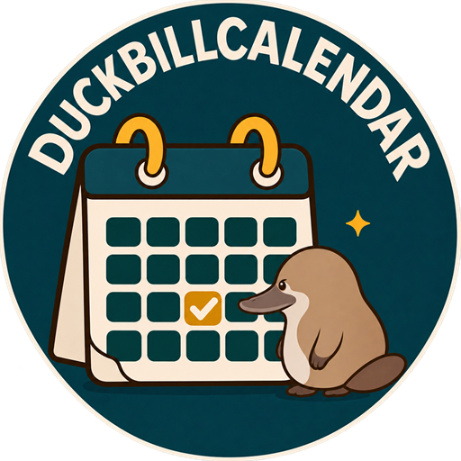

# DuckbillCalendar



한국 파이널판타지14의 주요 일정과 개인 이용권을 표시하는 Dalamud API15 플러그인입니다. 현재 버전은 **0.3.2.0**이며 한국어만 지원합니다.

## 설치

Dalamud 설정 → 실험적 기능 → 커스텀 플러그인 저장소에 아래 주소를 추가하고 저장합니다.

```text
https://raw.githubusercontent.com/PlatyDuckbill/DuckbillRepo/main/pluginmaster.json
```

설치 목록을 새로고침하고 **DuckbillCalendar**를 검색해 설치합니다. `/dbcal` 또는 `/duckbillcalendar`로 열 수 있습니다. [Release와 수동 확인용 ZIP](https://github.com/PlatyDuckbill/DuckbillCalendar/releases).

## 화면

- **달력**: 큰 년월 표시, 이전/다음·오늘·직접 월 이동, 격자 위 휠 이동. 창의 남은 너비와 높이를 달력에 사용합니다.
- 날짜나 표식을 누르면 그날의 **제목·기간·공식 링크**를 작은 팝업으로 보여줍니다. 상시 상세 패널·월 목록·미정 목록은 제거했습니다.
- 이벤트·업데이트·출시·PvP 주요 시점·대회·할인·개인 일정만 표시합니다. **공지 게시일과 PC방·크리스탈샵·홈페이지 점검은 달력에 넣지 않습니다.** 게임 서버 접속에 영향을 주는 점검은 표시합니다.
- 전장은 [에테르웨이](https://aether-way.com/frontline)의 날짜별 한국 서버 맵을 받습니다. 상단에 오늘·내일을 한 묶음으로 표시합니다. 날짜 칸의 맵 표기는 기본 꺼짐이며 표시 메뉴에서 켭니다. 없는 날짜의 회전을 추측하지 않습니다.
- **새소식**: 전체 너비의 날짜·제목 목록. 누르면 공식 사이트를 엽니다. 새소식 검색은 달력에 영향을 주지 않습니다.
- **설정**: 미드나이트·차콜·라이트 테마, 온라인 갱신·알림, 이용권 관리와 **업데이트 내역**. 한국어 리소스는 주 DLL에 포함됩니다.
- 이용권은 이름 없이 종류를 선택해 만료일을 등록하거나 **30·90·180일 / 직접 입력한 일·시간·분**를 충전합니다. 남은 기간에 더하며 만료된 이용권은 현재부터 계산합니다. `30분만`, `2시간 30분`, `30일 6시간 15분`도 충전할 수 있으며 저장 전 새 만료일·시각을 보여줍니다. 기존 만료 시각이 없으면 시간/분 충전 전에 입력합니다. 설정의 이용권에서 초기화 후 미등록 상태로 되돌릴 수 있습니다. 마감은 주황 배지, 만료는 붉은 배지로 구분하고 작은 칸에서는 경고 표식으로 축약합니다.

[10회 재설계·검토 기록](docs/design/REDESIGN-10-LOOPS.md), [현재 상태](docs/STATUS.md), [전장 수신](docs/development/FRONTLINE-SOURCES.md).

## 날짜별 노출과 개인화

- 같은 날 끝나는 점검은 시작·끝을 중복 표시하지 않습니다. 버전·날짜·공통 근거가 일치하는 업데이트와 점검은 한 항목으로 묶습니다.
- 예약·특전·할인은 검토한 캠페인 안에서 묶되 각각의 기간과 링크를 남깁니다. 얼리 시작과 구매 마감은 별개입니다.
- 그날 직접 등록한 일정·시작·마감·출시를 먼저 보여주고, 기간에 포함될 뿐인 이벤트는 기본 접힌 보조 영역에 작게 표시합니다.
- 종류별 아이콘·색·이름으로 카드를 구분합니다. 직접 등록한 일정은 선택한 분류의 아이콘과 이름을 사용합니다.
- 표시 메뉴에 분류별 아이콘·색상 미리보기를 표시합니다. 설정의 항상 보이는 ‘일정 색상 및 아이콘’에서 8개 분류의 아이콘·색을 바꾸거나 개별/전체 기본값으로 복원합니다. 아이콘 선택기와 펼친 목록에 실제 모양을 표시하며, 표식·날짜 카드·표시 메뉴에 함께 적용하고 재시작 후 유지합니다.
- 카드 상단의 숨기기로 해당 항목을 숨깁니다. 여러 공개 일정이 있는 카드에서는 선택할 항목을 고르고, 추가 메뉴에서 ‘관련 일정 모두’ 숨김을 선택합니다. 관련 범위의 개수·목록을 미리 확인할 수 있으며 분류 필터는 바뀌지 않습니다. 설정에서 개별/전체 복원합니다. 숨김은 달력 표시만 바꾸며 원문·뉴스·기존 알림 선택은 유지합니다.
- 개인 일정 날짜와 이용권 만료일은 미니 달력에서 선택합니다. 시각이 있는 일정은 달력 표식에도 `18:00 · 일정 이름`처럼 표시합니다. 날짜만 있는 일정은 시각을 만들지 않습니다. 직접 등록한 일정에는 관련 행사 숨김을 제공하지 않습니다.
- 공대별 **사용자 분류**를 만들고 개인 일정에 지정합니다. 이름·아이콘·색상·분류 기본 알림을 정하며 이름 변경은 ID를 유지합니다. ‘개인 일정’·‘공격대’를 기본 제공하며 삭제할 수 있습니다. ‘미분류 (분류 없음)’는 항상 선택할 수 있고, 분류 삭제 시 이동할 분류를 직접 정합니다. 일정과 개별 알림은 보존합니다.
- 분류 옆 **알림**에서 기본 시점을 정하고, 날짜의 일정 메뉴에서 해당 단계만 변경·끄기·기본값 복원을 선택합니다. 예외 목록은 검색과 12건씩 페이지 이동을 지원합니다. 상단 종 버튼은 메인 화면 안의 알림 내역을 엽니다. 알림 목록에서 시점·켜짐 상태를 확인하고 바로 켜거나 끕니다. 세부 편집은 배경을 덮지 않는 별도 창을 사용합니다. 직접 등록한 일정은 수정 창에서 알림도 편집합니다. [알림과 사용자 분류 사용법·처리 구조](docs/development/NOTIFICATIONS-AND-CATEGORIES.md).
- 차콜은 중성 회색·청록, 미드나이트는 깊은 남색·블루로 본문과 달력 칸까지 구분합니다. 넓은 창에서는 전장 요약을 상단 탭 옆에 배치합니다.

- **공격대 반복 등록**: 요일마다 다른 시각, 등록할 주 수와 주 간격, 실제 날짜 미리보기와 중복 제외를 지원합니다. 삭제 시 이번 일정·원래 순서상 이후·같은 등록 전체를 고릅니다. [반복 등록과 삭제 정책](docs/development/WEEKLY-RAID-SCHEDULES.md).
- 매년 **5월9일 오구데이**에는 실제 오리부리 꼬마친구 아이콘을 작게 표시합니다. 원격 데이터나 알림을 추가하지 않습니다.

[5회 검토·예외 상황·배포 후보 보고](docs/development/RELEASE-READINESS-2026-11-14.md).

[노출 규칙 심층 검토·전체 케이스](docs/design/DISPLAY-POLICY-RESEARCH.md).
## 빌드와 실행

.NET10과 완전한 Dalamud API15 참조가 필요합니다. [실행 안내](docs/development/BUILD-AND-RUN.md).

```powershell
./scripts/build.ps1
./scripts/check.ps1 -NoBuild
./scripts/prepare-dev.ps1
./scripts/prepare-release.ps1
```

`/dbcal`, `/duckbillcalendar`: 열기/닫기. `/dbcal settings`: 설정. `/dbcal changelog`: 업데이트 내역.

[최초 배포 내역](CHANGELOG.md)은 설정에서도 볼 수 있으며 인터넷 연결 없이 열립니다. [공개 배포·설치 목록·자동 수집 검증 기록](docs/development/RELEASE-0.3.2.0.md).

개발 중에는 `src/DuckbillCalendar.Plugin/bin/Debug/DuckbillCalendar.dll`을 등록하고 빌드 후 게임에서 다시 로드합니다. Plugin/Core/Infrastructure DLL을 함께 보존합니다. `prepare-release.ps1`은 깨끗한 소스 커밋에서 정식 ZIP·SHA256·단일 배포 객체를 만들며, 자동 게임 로드나 원격 게시를 수행하지 않습니다.

## 검증 범위

2026-11-14 최초 배포 검증: Core291 + Infrastructure203 + Model151 + native UI571 + 수집 도구117 + CLI30 = **1363개 검사**, 한국어 리소스222개와 별도 게시→수신→손상 유지→재시작 통합 smoke. native UI는 3개 테마·3개 창 크기·1/1.5/2배율에서 실제 MainWindow를 실행하며 클릭·팝업·휠·미니 달력 선택·시각 문자 입력·숨김/복원·충전 폼·전장 표시 독립·색상 설정 배치를 확인합니다. 사용자 분류·분류/개별 알림 저장·250개 일정 페이지 처리를 추가 확인합니다. 실제 DrawData를 PNG로 렌더링해 별도로 시각 검토합니다.

전장 HTTPS 실수신을 확인했습니다. 게임 GPU·게임 글꼴/DPI·게임 안에서의 로드 및 채팅 전달 확인은 별도입니다. [검증 기록](docs/VERIFICATION.md).

## 저장과 온라인 데이터

개인 일정·이용권·알림은 로컬 저장합니다. 공개 일정은 번들96건과 HTTPS 갱신을 사용합니다. ‘일정 최신 정보 받기’와 전장 수신은 새 설치에서 기본 켜짐이며 설정에서 끌 수 있습니다. 꺼두면 저장된 일정만 표시하며, 기존에 저장한 끄기 선택은 유지합니다. 제공자는 IP와 일반 HTTP 메타데이터를 볼 수 있지만 개인 일정·계정·캐릭터를 전송하지 않습니다.

공개 일정 확인 주기는 30분·1시간·3시간·6시간·12시간 중 선택하며 기본 1시간입니다. 마지막 확인·다음 확인 또는 실패 재시도 시각을 설정에 표시합니다. 검증된 캐시를 복원하면 남은 주기를 유지합니다. 주기를 바꾸면 마지막 성공 기준으로 재계산하며, 실패 시 15분→1시간→6시간으로 대기합니다. 수동 갱신의 5분 제한과 서버 Retry-After를 유지합니다. 플러그인 실행 중에만 확인하며 원본 수집·게시 주기와는 별개입니다.

0.2.3은 요청 제한·실패 대기를 재시작 후에도 유지합니다. 메타데이터 저장과 별도로 이전 정상 파일을 보관하며 오래된 SHA 캐시를 정리합니다. 전장 파일/HTTP 작업은 화면 처리 밖에서 수행하고 끄면 진행 중인 요청도 취소합니다. 수집·게시·수신의 검증 계약을 통일했습니다. [5회 점검·아키텍처 검토와 사용자 갱신 흐름](docs/development/PIPELINE-AUDIT-2026-11-13.md), [흐름 그림](docs/assets/data-update-flow.png).

전장 수동 확인 버튼은 제공하지 않습니다. 전장은 6시간 캐시를 사용하고 실패 시 15분 간격으로 재시도합니다. 6시간 이상 지난 값은 저장본으로 구분하고 24시간이 지나면 표시하지 않습니다. 커뮤니티 제공 자료를 공식 검증 자료로 표시하지 않습니다.

기본으로 전투·임무/PvP 중 공개 일정·전장 자동 요청을 보류하고 안전한 상태가15초 유지되면 재개합니다. 공개 일정의 수동 확인은 가능하며 기존 온라인 설정·5분 제한·서버 재시도 제한을 지킵니다. 게임 상태를 이유로 플러그인이 창을 자동으로 숨기지 않습니다. [최신 설정·충전 변경](docs/development/SETTINGS-AND-RENEWAL-REVIEW.md), [숨김 범위·ID 안정성 점검](docs/development/ACTIVITY-HIDING-REVIEW.md).

새 설치의 전체 알림·새 공지·새 이벤트·분류/일정 알림·채팅은 **기본 꺼짐**입니다. 기존에 직접 저장한 켜기/끄기 선택은 유지합니다. 분류/일정 목록의 체크박스로 바로 켜고 끄며 전체 알림이 꺼져 있으면 안내를 표시합니다. 새 공지·이벤트는 첫 정상 원격 수신을 기준으로 이후 새 ID부터 감지합니다. 실시간 푸시가 아니라 다음 일정 수신 시 확인하며 예시·번들·파일 가져오기는 기준을 만들지 않습니다. 정확한 시각과 최근 출처 근거가 있는 공개 일정만 시간 알림을 보냅니다. 개인·이용권·공대 분류는 시작/마감·만료 전 여러 시점을 설정할 수 있습니다.

게임 종료 중에는 알림이 동작하지 않으며 전투·임무·PvP·로딩·영상 중에는 채팅만 기다립니다. 내역은 최대200건 보관하고 출력 전 시각·설정을 재검사합니다. 소비 기록 저장 후 출력 전 종료되면 채팅이 누락될 수 있으며 기록된 알림은 재전송하지 않습니다. 요일별 시각을 정해 여러 주를 한 번에 등록할 수 있습니다. 무기한 자동 반복 생성·출석·공유·OS 알림은 이번 범위에 포함하지 않습니다.

[데이터 수집·갱신](docs/development/LIVE-DATA.md), [계약](data/contracts/v2/README.md), [의존성·출처](THIRD-PARTY-NOTICES.md).
