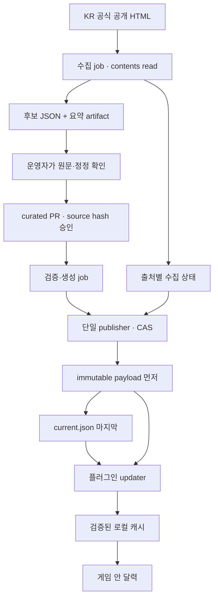

# 공개 일정 수집·게시 아키텍처

> 2026-11-12 구현 갱신: 아래는 11/11 설계 검토다. 실제 첫 개발판의 완료·대기는 [현재 상태](../STATUS.md)와 [10회 개발 기록](../development/DEVELOPMENT-LOOPS.md)을 따른다.

설계 검토일: 2026-11-11 KST. LLM을 사용하지 않는 구조다. 이 문서는 구현·운영 결정안이며, 실제 수집 workflow·배포 서버·공개 endpoint는 아직 가동하지 않았다. 기존 `data/feed.example.json`은 v1 목업 자료이고, 다음 구현의 계약은 v2 설계를 따른다.

## 1. 최종 구조와 책임

작은 일정 서비스에 상시 API 서버와 데이터베이스를 추가하지 않는다. **GitHub-hosted Actions로 짧게 수집하고, 운영자가 검수한 공개 파일을 정적 배포하며, 플러그인은 HTTPS로 읽는다.** 사람의 일정 판단과 장애 대응은 운영 업무로 남는다.



GitHub-hosted runner는 실행 환경을 제공하고 관리하므로 사용자의 PC를 상시 켜둘 필요가 없다. GitHub에 대한 서비스 의존성과 실행 환경의 외부 접속 제약은 남는다. [GitHub-hosted runners](https://docs.github.com/en/actions/concepts/runners/github-hosted-runners)

| 구성요소 | 책임 | 하지 않는 일 |
| --- | --- | --- |
| Collector | 목록·추적 원문 수집, 구조 검사, typed 후보·상태 생성 | 공식 계정 로그인, CAPTCHA 우회, 일정 자동 확정 |
| Curator | 이벤트 연결, 참여/수령 분리, 정정 적용, source hash 승인 | 수집 성공만으로 내용 검수 완료 처리 |
| Builder/Validator | 승인한 curated 입력에서 완전한 snapshot 생성 | 승인 후 달라진 데이터를 조용히 게시 |
| Publisher | revision·hash·상태 검사, 파일 기록, 마지막 pointer 교체 | force push, 낮은 revision으로 복구 |
| 정적 host | 공개 JSON 제공 | 사용자별 DB, 사용자 개인 정보 처리 |
| Plugin | HTTPS 수신, 계약 검증, 캐시, 현지 시각 표시 | 공식 웹 크롤링, 개인 일정 공개 업로드 |

## 2. 세 번의 검토에서 바뀐 점

| 루프 | 검토 | 발견 | 수정 |
| --- | --- | --- | --- |
| 1: 구조 설계 | Actions → curated → 정적 피드 | 수집·검수·갱신의 운영주체가 불명확, 최신성 지연 합산 누락 | 역할과 장애 owner를 명시하고 수집·검수·수신 시각 분리 |
| 2: 반례 | 같은 revision에서 수집 실패, 동시 게시, 원문 변경, rollback | 내용 revision만 확인하면 건강상태가 영원히 갱신되지 않음. concurrency만으로 최신순 보장 불가 | `publicationSequence`와 콘텐츠 revision 분리, 단일 CAS writer, 승인 source hash 재대조 |
| 3: 단순화·인수 기준 | 상태 파일 분리의 필요성, 초기 운영 가능성, 장기 이벤트 경고 | 별도 status 파일의 비용, 검수 나이와 source 전체 hash로 무관한 일정까지 stale이 되는 오경고 | 작은 `current.json`에 health를 inline. 대상 content revision의 기록별 비교 coverage·영향 ID·실패 경과로 freshness 판정. payload만 불변. 수기 모드와 Go/No-go를 먼저 준비 |

3차 최종 교차검토에서 루트의 결정·구현 계획·v2 계약을 대조했다. **오프라인 구현 착수는 Go, 공개 자동 수집·원격 서비스 출시는 조건부 No-go**다. 정책·hosted runner 접근·실제 검수 owner와 실기 관문을 통과해야 한다. 이 문서는 합의된 데이터 계약과 운영 기준을 기술한다.

## 3. 후보와 검수본을 분리한다

### 후보 artifact

수집 결과는 `candidate.json`, `collector-status.json`, 짧은 `summary.md`로 출력한다. 후보에는 `runId`, 실행한 `collectorVersion`, `sourceId`, 원 게시물 ID, 원문/최종 URL, `fetchedAt`, 관련 본문 SHA-256, 추출한 원문값, 파싱 결과와 오류 코드를 넣는다.

공식 페이지 전체를 무조건 artifact에 저장하지 않는다. 수집 정책과 fixture 필요성을 확인한 최소 본문·기간 부분만 남긴다. 로그인 정보·쿠키·개인 참여 실적·배너 원본은 수집하지 않는다. HTML은 데이터로만 읽으며 페이지의 스크립트나 설명문을 셸 명령으로 실행하지 않는다.

Actions artifact는 만료될 수 있고 일반 플러그인 사용자를 위한 익명 데이터 배포 주소가 아니다. 검수자는 GitHub 로그인을 거쳐 artifact를 내려받아 확인할 수 있다. 승인 결과와 필요한 최소 근거는 curated 파일로 옮긴다. artifact 보존이 영구 데이터 보존을 대신하지 않는다. [artifact 다운로드·만료](https://docs.github.com/en/actions/how-tos/manage-workflow-runs/download-workflow-artifacts)

### 검수본

`data/curated/kr/`에 이벤트 ID, phase ID, 시작·끝 각각의 시간 정확도, 상대 종료 조건, lifecycle, 출처와 승인 source hash를 저장한다. 후보 전체를 덮어써 curated를 만드는 방식은 금지한다. 필드별 변경 diff를 만들고 정정 대상과 phase를 확인한다.

한 공지가 여러 이벤트를 정정하면 별도 관계를 만든다. 예: 공지 3153 → 이벤트 766의 participation/reward-claim. 제목 유사성이나 최신 게시일 하나로 자동 병합하지 않는다. 이벤트가 목록에서 사라지면 missing 후보로 남긴다. 삭제·취소·기간 종료로 확정하지 않는다.

검수는 이 원문의 이 hash를 승인하는 행위다. 게시 전 재수집 결과가 달라졌거나, 최신 후보가 승인 hash와 다르면 재검수로 돌아간다. 원문 접근 불가 시 사람이 저장한 근거로 긴급 수기 게시할 수 있지만 그 사유·확인일·검수 범위를 기록한다. 검수 마감과 실제 게시 사이의 경쟁 상태를 완전히 제거할 수는 없으므로 주기적인 재확인을 유지한다.

### 수집 실패 시 수기 모드

운영자는 같은 curated 계약에 원문 링크·확인 시각·확정 정도를 입력한다. validator와 publisher 경로는 자동 수집 때와 같다. source health는 `manual-only` 또는 `blocked` 상태를 유지한다. 수동으로 일정 한 건을 확인했다고 전체 웹 수집이 정상이라고 표시하지 않는다.

## 4. v2 배포 계약

최종 계약의 기본 단위는 **mutable `current.json` 1개 + immutable content payload**다. 출처가 적은 초기 규모에서는 상태를 별도 파일로 내려받게 하지 않고 pointer에 함께 넣는다.

| 필드 | 의미 |
| --- | --- |
| `publicationSequence` | pointer 게시가 바뀔 때마다 증가. 콘텐츠가 같고 health만 바뀌어도 증가 |
| `generatedAt` | 이 pointer를 작성한 시각. 원문 확인일 또는 일정 검수일과 다름 |
| `content.revision` | 일정 콘텐츠 revision. 내용이 바뀔 때만 증가 |
| `content.schemaVersion` / `region` | 파서 선택과 서비스 범위 검사 |
| `content.path` | 같은 신뢰 origin 안의 허용된 payload 상대 경로 |
| `content.sha256` / `bytes` | 참조 payload의 정확한 바이트 일치 확인 |
| `health.sources[]` | source별 시도·성공·검수·미해결 변경 상태 |

출처별 health 필드는 `id`, `lastAttemptAt`, `lastSuccessAt`, `lastReviewedAt`, `normalizedSourceHash`, `approvedSourceHash`, `lastResult`, `completeCoverage`, `comparedContentRevision`, `pendingChanges[]`다. `id`는 이벤트의 `sourceId`와 연결한다. 한 출처가 실패해도 다른 출처의 성공 시각으로 덮어쓰지 않는다. source 전체의 두 hash는 진단용이며 일정별 freshness의 필수 일치 조건으로 쓰지 않는다. 신규 후보 한 건이 생기면 aggregate hash는 바뀌지만 기존의 무관한 기록은 여전히 일치할 수 있다.

기록별 비교는 수집기와 신뢰된 publisher 내부에서 수행한다. 원 게시물 ID/정규화 URL의 안정적인 `sourceRecordId`를 curated의 이벤트·phase에 연결하고 승인한 의미 hash와 관측 기록을 대조한다. `completeCoverage: true`는 `comparedContentRevision`의 모든 승인 기록을 비교했거나, 누락·변경을 해당 영향 ID의 pending으로 모두 열거했음을 뜻한다. source 전체의 원문이 변함없다는 뜻은 아니다. 파서 실패·페이지 탐색 상한 도달·비교 범위 불명은 complete가 아니다.

공개 `pendingChanges[]` 항목은 `kind`, `affectedEventIds`, `firstObservedAt`을 담는다. `affectedEventIds: []`는 새 미등록 후보라 기존 일정 영향 없음, 특정 ID 배열은 그 일정의 재확인 필요, `null`은 영향 범위를 결정하지 못해 source 전체 재확인 필요를 뜻한다. 공개 pointer에 모든 unchanged record를 나열하지 않는다. 배열이 64KiB 상한을 넘으면 조용히 잘라 complete로 게시하지 않고 `completeCoverage: false`와 `coverage-incomplete`를 표시한다. 상세 후보는 검수 artifact에 남긴다.

이 coverage는 **신뢰된 수집기·publisher의 보고**다. 플러그인이 official HTML을 독립적으로 다시 읽어 사실을 증명하는 구조가 아니다. hash 일치·스키마 통과도 보고자의 비교 누락이나 잘못된 해석을 증명해 주지 않는다. 따라서 fixture·shadow 운영에서 원문/승인 기록의 대응과 영향 ID 누락을 점검해야 하며, 보고 오류를 고치는 운영자 경로를 유지한다.

`lastResult`는 `not-run`, `ok`, `http-error`, `blocked`, `parse-error`, `coverage-incomplete`, `manual-only`처럼 코드로 유지한다. `lastSuccessAt`은 유효한 문서·예상 구조·추적 범위를 확인한 경우에만 갱신한다. HTTP 200 오류 화면은 성공이 아니다. `not-run`·성공 시각 null·`completeCoverage: false`·`comparedContentRevision: null`인 예시는 정상으로 판정하지 않는다. 수집이 아예 실행되지 않으면 새 상태 파일도 없으므로 클라이언트는 기존 시각의 경과로 stale을 판단한다.

클라이언트의 다운로드 성공은 `lastClientCheckedAt`이라는 별도 로컬 값이다. HTTP 304는 이를 갱신하지만 웹사이트의 마지막 수집·검수 시각을 현재로 바꾸지 않는다. HTTP 캐시·중간 CDN 때문에 최신 pointer 수신이 즉시 보장된다고 가정하지 않는다. [HTTP caching 표준](https://www.rfc-editor.org/rfc/rfc9111.html)

`lastReviewedAt`이 72시간 이전이라는 이유만으로 모든 공개 일정을 오래됐다고 판단하지 않는다. 일정의 freshness는 최근 `lastSuccessAt` + `completeCoverage === true` + `comparedContentRevision === activeContentRevision` + 그 일정에 영향 주는 미검수 변경 없음 + 규칙 유효기간으로 판단한다. source 전체 hash가 달라도 기록별 비교가 끝났고 해당 일정이 영향 ID에 없으면 유효할 수 있다. 검수 시각은 사람이 의미를 판단한 시각으로 유지한다. 페이지 공통 footer·조회수·광고 변화는 의미 변경 hash에서 제외한다.

새 이벤트 한 건의 후보가 생겼다고 같은 출처의 모든 기존 일정을 무효로 만들지 않는다. 확인된 영향 ID가 있으면 해당 일정에 검수 대기를 표시한다. 영향 범위를 결정할 수 없는 파서 손상·불완전 수집은 출처 범위의 재확인 필요로 다룬다. 중단/오래됨 상태와 단순 ‘검수 대기 후보 있음’을 구별한다.

새 payload가 아직 적용되지 않아 active revision이 이전 값이면 새 health의 coverage를 이전 active 내용의 freshness 증거로 쓰지 않는다. 수집기 상태는 보여주되 기존 콘텐츠 재확인 여부는 마지막으로 해당 revision에 적용한 증거로 판단한다. 다른 source의 변경으로 콘텐츠 revision이 올라간 경우 publisher는 해당 source의 승인 기록 집합과 의미 hash가 동일함을 내부에서 확인한 때만 기존 관측 증거를 새 `comparedContentRevision`에 연결한다. 관측 시각은 그대로 유지하며, 증명할 수 없으면 coverage를 false로 둔다.

### revision 규칙

- `publicationSequence`가 낮으면 새 활성본으로 교체하지 않는다.
- `content.revision`이 낮으면 교체하지 않는다. 같은 revision인데 다른 SHA면 오류다.
- 같은 콘텐츠 revision·같은 SHA와 더 높은 publication sequence의 health 갱신은 허용한다.
- rollback은 과거 정상 콘텐츠를 **새롭고 더 큰 콘텐츠 revision**으로 다시 생성하는 작업이다. 과거 source 확인일을 새 확인일로 바꾸지 않는다.
- 단순 수집 성공으로 콘텐츠 revision과 일정별 revision을 증가시키지 않는다. 관심·알림 중복 방지는 content revision이 아니라 안정 ID와 마감 경계를 사용한다.

### 배포 주소

이름은 배포 전에 확정하며 아래는 미게시 설계 예시다.

```text
calendar-data 브랜치
  kr/current.json
  kr/revisions/000001.json
```

revision 파일명은 불변이며 같은 번호의 내용을 덮어쓰지 않는다. 파일 hash는 pointer에서 확인하고 로컬 캐시는 content-addressed로 저장한다. 플러그인에는 `current.json`의 신뢰 origin과 경로를 고정한다. payload 경로는 HTTPS·동일 origin·허용된 prefix만 허용하고 절대 URL·`..`·인코딩된 경로 이탈·예상 밖 redirect를 거부한다. 모든 URL 문자열을 임의 fetch 경로로 취급하지 않는다. 원문 링크 열기 allowlist는 배포 파일 다운로드 allowlist와 별개다.

SHA-256은 파일 혼합·손상·버전 불일치를 탐지한다. 동일 origin이나 게시 계정이 침해돼 current와 payload가 함께 바뀌는 공격의 인증 수단은 아니다. 초기 신뢰 경계는 TLS·저장소 권한·보호된 게시 절차다. 별도 서명은 키 운영과 복구까지 설계한 뒤 후속으로 판단한다.

## 5. Publisher의 단일 쓰기 절차

상태 갱신도 콘텐츠 게시도 **동일 publisher 경로**를 통과한다. 수집 workflow와 수동 긴급 게시가 각자 current를 덮어쓰지 않는다.

1. 운영자가 승인한 main SHA와 승인 입력 digest를 고정한다.
2. `calendar-data`의 현재 HEAD/current를 새로 읽고 예상 publication sequence를 기록한다.
3. build 결과에 source·region·schema·범위·크기·중복 ID·phase·정정/철회·예시 데이터 혼입 검사를 수행한다.
4. content 변경이면 다음 revision으로 payload를 생성하고 SHA를 계산한다. 같은 파일명·다른 bytes가 이미 있으면 실패한다.
5. payload 파일을 먼저 기록한다. 필요한 경우 별도 선행 commit을 push하고 익명 GET의 bytes/hash를 확인한다. 아직 current는 바꾸지 않는다.
6. 최신 main/승인 digest와 remote HEAD를 다시 검사한다. 최신 승인본이 아니거나 source별 더 최신 관측이 존재하면 재계산한다.
7. content pointer와 최신 health를 담은 `current.json`을 마지막에 기록하고 non-force push한다. 다른 writer의 HEAD 변화가 있으면 실패 후 새로 계산한다.
8. 익명 GET으로 current와 참조 payload를 확인한다. 전파 지연이면 제한된 재시도 후 게시 미확인으로 보고한다. 로컬 성공만으로 외부 확인 완료라고 보고하지 않는다.

동일 concurrency group에서 `cancel-in-progress: false`를 사용하되 이것을 정렬·정합성 보장으로 해석하지 않는다. queued run은 교체되거나 실행 순서가 달라질 수 있으므로 job 입력을 맹목적으로 순서대로 적용하지 않고 remote HEAD와 승인 SHA를 비교한다. 상태 artifact에도 관측 시각/run ID를 붙여 늦게 끝난 과거 수집이 새 상태를 되돌리지 않도록 한다. [GitHub concurrency](https://docs.github.com/en/actions/how-tos/write-workflows/choose-when-workflows-run/control-workflow-concurrency)

payload와 current를 한 commit에 넣는 것만으로 CDN의 각 URL 전파가 동시에 완료된다고 보장할 수 없다. 신규 current를 먼저 받은 클라이언트가 payload 404를 만나면 기존 활성 캐시를 보존하고 짧게 재시도한다. 새로운 current가 가리킨 SHA와 맞지 않는 파일을 이전 payload로 임의 대체하지 않는다.

## 6. 권한과 workflow 연결

| 단계 | 기본 권한 | 입력 신뢰 |
| --- | --- | --- |
| collect | `contents: read` | 공식 사이트 응답도 비신뢰 텍스트 |
| validate PR | `contents: read` | 외부 PR 포함. 게시 자격 증명 없음 |
| review/merge | 운영자의 기존 저장소 권한 | 검수 diff·source hash·검사 결과 확인 |
| publish | 해당 job만 `contents: write` | 보호된 main의 pinned SHA와 검증된 typed 결과 |

GITHUB_TOKEN의 저장소 `contents: write`를 특정 브랜치만 쓸 수 있는 권한으로 설명하면 안 된다. publish 실행 범위와 repository rules로 보완하고, 수집 job에는 이 권한을 주지 않는다. 저장소 밖의 권한이 필요한 설계를 먼저 만들지 않고, 새 장기 토큰·개인 계정 토큰·외부 비밀을 자동 생성하지 않는다. GitHub 문서는 job별 최소 권한 설정을 권고한다. [GITHUB_TOKEN 권한](https://docs.github.com/en/actions/tutorials/authenticate-with-github_token)

외부 HTML 처리와 게시를 같은 writable job 안에 합치지 않는다. third-party action은 검토한 commit SHA로 고정하고, shell에 원문·제목·PR body를 문자열 보간하지 않는다. 게시 job은 후보의 명령·파일 경로를 실행하지 않고 스키마와 허용된 데이터만 읽는다. `pull_request_target`로 외부 PR 코드를 write token과 함께 실행하는 경로는 초기 구성에 포함하지 않는다.

수집 결과를 GITHUB_TOKEN으로 commit한 뒤 `push` workflow가 자동으로 이어질 것이라고 가정하지 않는다. 현재 GitHub 문서는 이 token의 push가 후속 push run을 만들지 않는다고 설명한다. 자동 생성/수정 PR의 일부 이벤트는 승인 대기 CI를 만들 수 있으므로 이것도 운영 설정을 확인해야 한다. 초기안은 운영자 PR merge → publisher 또는 명시적 `workflow_dispatch`로 연결한다. 새로운 토큰을 만들어 이 동작을 우회하는 구성을 기본으로 삼지 않는다. [workflow 연결 동작](https://docs.github.com/en/actions/how-tos/write-workflows/choose-when-workflows-run/trigger-a-workflow)

## 7. 수집 Go/No-go

| 사전 확인 | Go | No-go 대응 |
| --- | --- | --- |
| 사이트 정책·수집/요약 허용 범위 | 공개 읽기 범위와 운영 방침을 확인 | 수기 원문 링크 등록으로 시작 |
| GitHub-hosted runner의 실제 접속 | 비로그인 HTML과 예상 본문 확보 | 해당 출처 자동 수집 중지. PC/게임 클라이언트 우회 수집으로 전환하지 않음 |
| 파서의 최소 구조 | 본문·기간 라벨·게시물 ID 범위를 확인 | 기존 정상본 유지, parse-error |
| 검수 담당·대체 담당 | 누가 언제 확인할지 정함 | 자동 수집만으로 완성 서비스라고 배포하지 않음 |
| 운영 계정·repo 권한 | 최소 권한으로 수동/예약 게시 확인 | 오프라인/수기 파일을 먼저 출시 |

로컬 PowerShell에서 HTTP 200을 받았다는 관찰은 GitHub-hosted runner의 네트워크에서도 같은 결과를 보장하지 않는다. 데이터센터 IP·지역·차단 정책이 다를 수 있으므로 실제 runner에서 비로그인 접근을 먼저 검증해야 한다. robots.txt 오류 화면도 수집 허용의 근거가 아니다. 정책 확인은 별도 운영 결정이며 이 문서가 이용허락을 대신하지 않는다.

수집 job은 목록당 낮은 빈도로 요청하고 403/429·로그인·오류 redirect·CAPTCHA를 만나면 중단한다. retry 폭주·인증 우회·개인 cookies를 사용하지 않는다. 정상 구조가 아닌 HTML 200, 최근 목록 0건, 급격한 감소, 파서 버전 변경 직후는 검수 신호다. 누락이 정상 종료처럼 보이지 않게 추적 진행 이벤트와 최근 공지를 겹쳐 확인한다.

## 8. 최신성·운영 부하

자동 수집 간격만으로 사용자가 보는 최신성을 설명할 수 없다.

```text
사용자 반영 지연 = 수집 대기 + 검수 대기 + 게시/전파 + 클라이언트 확인 대기
```

기존안의 수집 2시간·하루 2회 검수·클라이언트 6시간 조합은, 모든 단계가 정상이어도 단순 합산 약 20시간의 대기가 생길 수 있다. 사람이 검수하지 않거나 예약 실행이 누락되면 상한은 없다. 따라서 제품은 ‘마감 계획용’으로 설명하고 긴급 점검의 실시간 경보기로 설명하지 않는다.

최종 기본값은 2시간 수집, 운영자 하루 2회 검수, client 갱신 1시간 + 0~10분 jitter다. 검수가 12시간 이내 이뤄진다는 가정 아래 정상 단계들의 잠재 대기는 약 15시간 10분이며 상한/SLA가 아니다. 6시간은 선택 가능한 저빈도 설정이다. 전송 실패는 15분→1시간→6시간 backoff, 수동 새로고침은 5분 간격 제한을 둔다. 강제 새로고침은 client의 캐시 확인만 앞당기며 공식 수집과 운영자 검수를 즉시 실행하지 않는다. P0는 모든 의미 변경을 검수하고, 안정적인 자동 추출 유형의 자동 게시는 P1의 표본 평가 후 판단한다.

GitHub schedule은 지연·누락될 수 있고, 공개 저장소의 활동이 오래 없으면 비활성화될 수 있다. 정각을 피한 UTC `17 */2 * * *`와 수동 실행 버튼을 제안한다. 같은 scheduler에서 실행하는 자체 heartbeat만으로 scheduler의 완전 정지를 확실하게 감시할 수는 없다. 운영자는 GitHub 실패 알림 설정·Actions 이력·client stale 표시를 함께 확인한다. 초기 단계에서 외부 모니터링 SaaS를 필수 의존성으로 추가하지 않는다. [schedule 제약](https://docs.github.com/en/actions/reference/workflows-and-actions/events-that-trigger-workflows#schedule)

운영자는 플러그인 사용자에게 이메일·Discord 메시지를 자동 전송하지 않는다. 작업 실패 안내는 GitHub의 기존 계정 알림을 운영자가 설정하고, 제품은 수신 상태와 오래됨을 화면 안에 표시한다.

### 운영 owner

| 문제 | owner | 첫 조치 | 사용자에게 보이는 결과 |
| --- | --- | --- | --- |
| schedule 비활성/실패 | 저장소 관리자 | Actions 이력 확인, 원인 복구 뒤 수동 실행 | 마지막 수집 시각 경과 |
| 원문 구조/차단 | 수집기 유지보수자 | 자동 수집 중지, fixture·수기 모드 | 해당 source 재확인 필요 |
| 기간·정정 해석 | 일정 검수자 | 기존값과 새 원문 비교, curated PR | 검수 대기/정정 안내 |
| 잘못된 데이터 게시 | 게시 담당 | 정상본을 새 revision으로 재게시 | 기존 캐시 또는 수정된 일정 |
| host 장애 | 배포 담당 | 익명 GET 확인, 서비스 복구 | 캐시 사용·갱신 실패 |
| 담당자 장기 부재 | 프로젝트 소유자 | 수기/오프라인 운영으로 축소, 안내 갱신 | 오래된 공개 정보, 개인 기능 유지 |

같은 사람이 여러 역할을 맡을 수 있으나, 출시 전에 실제 담당과 대체 경로를 정해야 한다. 서버 비용이 작다는 사실이 검수 노동을 없애지 않는다.

## 9. 배포 대안과 전환 조건

| 대안 | 적합성 | 초기 판단 |
| --- | --- | --- |
| GitHub Actions + raw 공개 파일 | 기존 저장소와 연계, 적은 상태, 구현 작음 | 최초 선택. cache header/SLA 직접 제어가 제한적이라는 전제 |
| Actions + GitHub Pages | 운영 상태 페이지와 JSON을 함께 제공 | 선택 대안. 사이트 게시와 변경 전파 단계가 추가됨 |
| Actions/예약 job + object storage/CDN | 캐시 정책·도메인·트래픽 관리 강화 | 사용자 규모·전파 요구가 커질 때 |
| serverless Worker + scheduler | 수집·제공 정책을 직접 구성 | 별도 계정·요금·비밀·관측 업무가 필요할 때 판단 |
| 상시 서버·DB | 복잡한 편집 권한·사용자별 API가 있을 때 | 현재 범위에는 보류 |
| 운영자 수기 파일 + 플러그인 파일 import | 사이트 접근·자동화가 막혀도 제품 유지 | 항상 유지하는 대체 경로 |

Pages에는 대역폭·크기·rate limit 등 서비스 제한이 있고 전용 데이터 API SLA를 제공한다고 가정할 수 없다. raw도 무제한 CDN이나 영구 가용성 보장으로 약속하지 않는다. 임의의 가격·무료 한도를 고정해 예산을 확약하지 않고 실제 저장소 계획과 사용량을 출시 전에 확인한다. [Pages 제한](https://docs.github.com/en/pages/getting-started-with-github-pages/github-pages-limits)

사이징 예시: 사용자 1,000명이 하루 8시간 실행하고 1시간마다 확인하면 하루 약 8,000회의 작은 pointer 조회다. 100KiB 콘텐츠를 하루 한 번씩 새로 받는다고 가정하면 콘텐츠만 약 100MB/일이다. 이는 실제 이용량·ETag 효과·배포 빈도 측정이 없는 **설계 계산 예시**다. 계정 수·client heartbeat를 서버에 수집하지 않고도 GitHub 사용량과 공개 host 지표로 운영 부담을 확인할 수 있다.

## 10. 단계별 인수 기준과 복구 연습

1. **수기 파일 파일럿:** 운영자 1명이 정정/취소/상대 종료를 등록하고 validator가 잘못된 기간·source 누락·예시 데이터를 거부한다.
2. **read-only 수집:** GitHub-hosted runner에서 공식 HTML 접근·오류 redirect·차단·정상 0건을 구분한다. 허용 범위 미확인이면 이 단계 Go를 내리지 않는다.
3. **후보 검수:** 최근 표본을 수기로 정답화해 누락·중복·잘못된 phase를 점검한다. 추출 성공률만 세지 않고 기간 정정 누락을 별도 센다.
4. **수동 게시:** current/payload hash, 같은 revision 다른 bytes, CAS 충돌, 늦은 run, 새 source 변경을 재현한다. token push 후속 실행이 아닌 명시적 연결을 확인한다.
5. **client 연결:** same content/new health, source 한 곳 실패, pointer만 최신/payload 404, 손상 JSON, 낮은 revision, offline cache를 확인한다.
6. **복구 연습:** 과거 정상 콘텐츠를 새 revision으로 게시하고 개인 일정·관심 설정이 보존되는지 확인한다. 높은 revision 악성/오류 파일 뒤 정상 복구도 ‘더 높은 새 revision’으로 수행한다.
7. **1주 shadow 운영:** 실제 사용자에게 자동 공개하기 전에 수집·검수 소요, 수집 차단, pending 변경 나이, 수기 수정 빈도를 기록한다. 운영자가 감당할 수 있는 범위를 확인한 뒤 자동 게시 유형을 늘릴지 결정한다.

첫 출시에서 보류하는 것은 LLM, DB, 별도 관리자 인증 서버, 다중 CDN failover, 장기 서명키 운영, 사용자 원격 telemetry, 자동 생성 PR 봇이다. 후보·검수·불변 payload·작은 pointer·로컬 캐시의 흐름이 먼저 검증돼야 한다.

## 11. 3차 최종 판정

루트의 결정 기록, 단계별 구현 계획, `data/contracts/v2` 예시와 대조했다. `generatedAt`, `health.sources[].id`, nullable 진단 hash, coverage 대상 revision, 영향 ID가 있는 `pendingChanges[]`, revision 파일 경로에 맞췄다. `not-run`·coverage false인 계약 예시를 실제 수집 성공으로 판단하지 않는다. v2 payload 전체 production schema·validator가 없으므로 Boundary schema와 hash 일치만으로 공개 서비스 완성을 선언할 수 없다.

남은 상위 위험은 다음 세 가지다.

1. **수집 가능성:** 공식 정책·요약 재배포 범위와 실제 GitHub-hosted runner 접근은 아직 확정되지 않았다. 실패하면 수기·오프라인 경로로 진행한다.
2. **운영 지속성:** 검수 담당과 대체 담당, 약 15시간 10분이라는 정상 가정의 잠재 지연을 받아들일 운영 범위가 필요하다. 예약 수집만 가동해도 데이터 정정이 자동 완료되지는 않는다.
3. **부분 실패 실증:** CAS 충돌, 전파 지연, 같은 pointer 재시도, 디스크 실패, rollback과 KR 인게임 수신은 아직 구현·검증 전이다. 마지막 정상본 보존을 실제로 재현한 뒤 원격 갱신을 연결한다.

**Go:** 오프라인 계약·Core·개인 저장·달력, read-only 파서 fixture, 수기 검수 CLI 설계/구현. **조건부 No-go:** 실제 공식 사이트 예약 수집 가동·일반 사용자 공개 자동 갱신 출시. 외부 관문을 통과하기 전에도 설계와 로컬 구현 작업은 계속할 수 있다.
