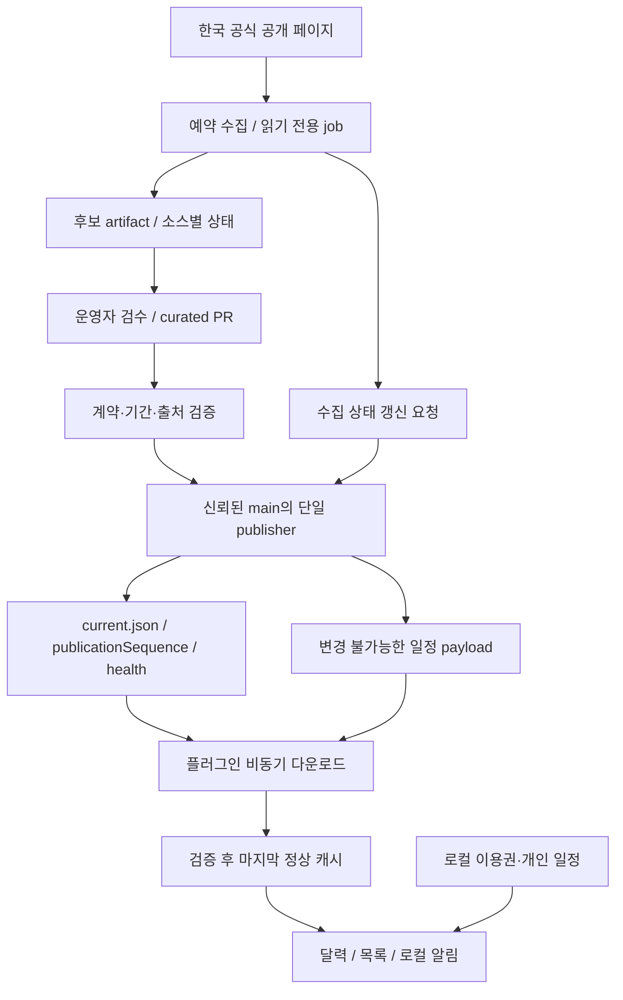

# 3회 아키텍처 검토와 최종 결정

> 2026-11-12 구현 갱신: 아래는 11/11 설계 검토다. 실제 첫 개발판의 완료·대기는 [현재 상태](../STATUS.md)와 [10회 개발 기록](../development/DEVELOPMENT-LOOPS.md)을 따른다.

검토일 2026-11-11 · 대상: LLM 없는 한국 서비스 일정 수집 및 Dalamud 플러그인 · 설계안 v0.3

## 결론

**GitHub-hosted Actions에서 수집 → 운영자 검수 → 정적 JSON 게시 → Plugin의 선택적 HTTPS 다운로드·로컬 캐시**를 초기안으로 채택한다. DB·상시 서버·LLM·사용자 인증·개인 정보 업로드는 초기 범위에 넣지 않는다. 수집과 게시를 분리하고 공개 피드에는 개인 데이터를 넣지 않는다.

이 판단은 구현 착수에 충분한 설계안이라는 뜻이다. 공식 사이트의 자동 수집 허용 범위, GitHub 실행 환경의 접근 가능성, KR Dalamud 실기와 공개 PvP 일정의 공식 저장소 적합성은 검증 관문이다. 지금 존재하는 것은 HTML 목업과 계약 예시이며 실행 중인 수집 서비스나 플러그인 DLL은 없다.

상세 책임 문서는 [수집·배포](DATA-PIPELINE.md), [플러그인](PLUGIN.md), [기능·UX](../product/FEATURE-PLAN.md), [구현 순서](../development/IMPLEMENTATION-PLAN.md)다. 이전 [데이터 설계](../DATA-DESIGN.md)의 v1 예시는 이 결정과 충돌할 경우 이 문서 및 v2 계약이 우선한다. v1 파일을 운영 피드로 게시하지 않는다.

## 세 번의 루프

각 루프는 설계 제시 → 다른 영역의 반박 → 수정·확인으로 구성했다. 데이터·플러그인·제품 분석을 병렬로 수행하고 주 담당자가 교차 검토했다.

| 루프 | 발견한 문제 | 수정 결정 | 확인 방식 |
| --- | --- | --- | --- |
| 1 / 구조 분해 | 수집 성공과 내용 검수·클라이언트 다운로드를 같은 최신성으로 취급. phase 전체 precision으로 시작 확정/종료 미정을 표현. 운영자 도구가 일반 탭에 노출 | 수집·검수·다운로드 시각 분리, 시작/종료 경계별 모델, 운영 도구 기본 숨김 | 현재 코드·문서와 Fisher 참조, 공식 GitHub/.NET 자료 대조 |
| 2 / 실패 반박 | 내용이 그대로면 수집 장애를 전달하지 못함. collector write 권한, 동시 게시, 낮은 revision 롤백, 월간 목록 누락, 수령 막대 과밀 | mutable current에 health를 inline, immutable payload, 단일 publisher+CAS, 새 revision 롤백, 기간 겹침 목록, 막대 3행·수령 막대 선택 | 세 영역 교차 반박과 목업 수정. 계약 파일·변경 상태 재검사 |
| 3 / 구현 관문 | 새 pointer의 payload 실패 후 같은 sequence를 무조건 거부하면 영구 복구 불가. source aggregate hash가 새 공지 하나로 달라지면 기존 일정까지 오경고. 전장 패치/자정 오표시와 하드코딩 | advertised/active 분리, 같은 sequence+같은 digest 재시도, record별 비교→coverage/비교 revision/영향 ID 보고, 날짜별 규칙 검증과 동적 표시 | 최종 교차 검토, 계약·목업 로직 검사, 단계별 Go/No-go 정리 |

검토는 독립적인 세 전문 분석의 의견을 합친 것이며 외부 보안 감사나 실기 검증을 뜻하지 않는다. 각 루프의 잔여 사항은 아래 위험 표와 상세 문서에 남긴다.

## 구성과 신뢰 경계

외부 HTML·후보 artifact는 신뢰하지 않는 입력이다. 수집 본문을 셸 명령이나 코드로 평가하지 않는다. 수집 job에는 공개 피드 쓰기 권한을 주지 않는다. 게시 job은 신뢰된 main의 검증된 코드만 실행하고 HTML 수집을 수행하지 않는다. raw 파일의 SHA-256은 전송·내용 불변성 검사이며 저장소 자체 침해를 검증하는 서명이 아니다.

개인 캐릭터·계정 별칭·종료 시각·알림은 로컬 소유다. 공개 다운로드에도 제공자는 IP·일반 HTTP 메타데이터를 관찰할 수 있으므로 ‘통신 시 아무 정보도 전송되지 않는다’고 표현하지 않는다. 앱 자체의 개인 데이터 업로드·텔레메트리는 넣지 않는다.

## 결정 목록

| ID | 결정 | 이유와 재검토 조건 |
| --- | --- | --- |
| ADR-01 | 초기 hosting은 GitHub raw의 데이터 전용 브랜치 | 작은 파일·기존 저장소 운영에 맞음. rate·대역폭·정책·접근 문제가 실제 관찰되면 정적 CDN으로 전환 |
| ADR-02 | 수집 read-only, 검수 curated PR, 게시 단일 writer | 파서 입력과 게시 권한을 분리. main 승인 절차가 있는 경우에도 자동 승인으로 바꾸지 않음 |
| ADR-03 | `current.json` + immutable payload 두 종류 파일 | health만 변해도 게시 가능. 별도 health payload·DB·큐는 초기 제외 |
| ADR-04 | `publicationSequence`와 `content.revision` 분리 | 새 수집 상태와 일정 변경은 다른 사건. 롤백도 기존 내용을 새 content revision으로 재발행 |
| ADR-05 | payload의 start/end를 각각 Boundary로 모델링 | 확정 시작·조건형 종료·날짜만 확정·미발표를 독립 표현. 시각을 만들지 않음 |
| ADR-06 | FeedImport/Core/Plugin 분리, public feed는 전역 수명 | 클라이언트 HTTP와 게임 UI 책임 분리. 캐릭터 전환은 개인 projection만 무효화 |
| ADR-07 | 캐시 우선·선택 갱신·1시간 TTL | 네트워크 실패에도 기본 기능 유지. TTL은 1시간+0~10분 jitter, 수동 확인 최소 5분, 선택 저빈도 6시간 |
| ADR-08 | 공개 PvP는 정적 일정·오늘/내일 필드 안내만 | 전투 분석·매칭 자동화 범위 제외. 공식 저장소 적합성은 별도 확인 |
| ADR-09 | 일반 화면은 달력·새소식·이용권·설정 | 운영 도구는 선택 표시. 상단 탭·컴팩트 배치와 기간 표시 선택을 유지 |

## v2 공개 계약

검토용 예시: [current.example.json](../../data/contracts/v2/current.example.json), [payload](../../data/contracts/v2/revisions/000001.json), [Boundary schema](../../data/contracts/v2/boundary.schema.json). `isExample: true`이며 게시 준비가 끝났다는 뜻이 아니다. 완전한 production feed schema와 importer는 구현 단계에서 만든다.

`current.json`은 다음 책임만 갖는다.

- `publicationSequence`: 내용·건강 상태를 게시할 때 단일 writer가 증가시키는 값.
- `content`: region, schemaVersion, content revision, 상대 경로, SHA-256, 바이트 수.
- `health.sources`: source별 마지막 시도/성공, 내용 검수 시각, `completeCoverage`, `comparedContentRevision`, 영향 ID를 가진 `pendingChanges[]`와 결과. 전체 aggregate만으로 소스별 실패를 숨기지 않는다.
- `generatedAt`: 파일 생성 시각. 수집 성공·검수 완료로 해석하지 않는다.

현재 pointer는 64KiB, payload는 2MiB, 이벤트 10,000건 상한을 제안한다. 둘 다 실제 stream byte 상한을 적용한다. source registry·문자열 길이·날짜 범위도 제한한다. 데이터 파일의 `isExample: true`는 운영 클라이언트에서 거부한다.

source가 304를 반환하면 수집 시도·성공은 갱신하되 의미 검수 완료는 갱신하지 않는다. 원문 내용이 바뀌었는데 검수가 끝나지 않은 경우 마지막 정상 일정과 함께 ‘변경 확인 대기’를 전달한다.

수집과 검수가 모두 정상인지의 판정은 단순 검수 나이 72시간이나 source 전체 hash 일치가 아니다. 수집기는 **내부적으로 sourceRecordId별 승인 내용과 비교**하고 공개 health에 그 비교가 완전한지와 어떤 content revision에 대한 것인지 기록한다. 일정의 유효 확인에는 `completeCoverage: true`, `comparedContentRevision == activeContentRevision`, 최근 `lastSuccessAt`, 해당 ID에 미해결 변경이 없음, 규칙 유효 범위가 필요하다. source aggregate hash는 진단용이다. 새 공지 하나로 전체 hash가 달라져도 나머지 정상 일정을 무효화하지 않는다.

`pendingChanges[].affectedEventIds`는 `[]`이면 아직 공개되지 않은 신규 후보로 기존 일정에 영향 없음, `[id,...]`면 해당 일정만 재확인, `null`이면 영향 범위 미확정으로 해당 source 전체 재확인이다. coverage 누락·pending 크기 초과를 조용히 자르지 않고 `completeCoverage: false`로 표시한다. 새 content revision의 비교 근거는 아직 옛 revision을 쓰는 클라이언트의 freshness 증거로 재사용하지 않는다. 새 content에 대한 비교 근거 재연결은 publisher가 관련 record의 승인 내용이 그대로임을 확인할 때만 허용하고 관측 시각은 바꾸지 않는다.

이 검사는 수집기의 범위 보고가 정직하고 정확하다는 신뢰 위에 있다. 클라이언트가 공식 웹을 다시 수집해 보고를 독립 증명하는 구조는 아니다. `not-run`, 마지막 성공 없음, coverage false/null은 정상 증거가 아니다. 장기 일정은 원문이 변하지 않았다면 매일 수집 때 사람이 다시 승인할 필요가 없다.

### 클라이언트 수락 상태

1. HTTPS current 다운로드 → 크기·region·sequence·경로·필수 source 확인.
2. 낮은 publicationSequence는 거부. 같은 sequence의 다른 bytes/digest도 거부. 같은 sequence·같은 pointer는 미완료 payload 재시도에 사용할 수 있다. 이미 광고받은 content revision은 아직 미수락이어도 hash가 바뀔 수 없다. 교정은 새 revision으로만 한다.
3. 신뢰한 health 관측과 `advertisedContent`를 기록한다. 이는 새 일정 적용 성공을 뜻하지 않는다.
4. payload가 이미 캐시에 있으면 hash를 확인해 재사용. 없으면 전체 deadline·stream 상한 안에서 내려받고 전체 검증한다.
5. 성공할 때만 `activeContent`와 content high-water를 올린다. health만 새로 받아도 잘못된 payload로 active를 교체하지 않는다.
6. 캐시 디렉터리의 content-addressed 파일을 먼저 쓰고, local active pointer를 원자 교체한다. 쓰기 실패·게임 unload 시 이전 active가 남아야 한다.

`remote advertised revision 13 / active revision 12 / 다운로드 실패` 같은 상태를 정확히 보여준다. 수집기는 정상이어도 사용자의 다운로드가 실패할 수 있고, 사용자는 최신 파일을 받아도 운영자의 검수가 오래됐을 수 있다.

## 시각과 알림

시각이 명시된 경계만 시·분 카운트다운에 사용한다. 날짜만 있는 경계는 현지 날짜를 보존하고 임의 23:59를 붙이지 않는다. 상대 종료는 대상 ID와 원문을 유지한다. ‘시즌 종료 전’과 ‘패치 개방 후’를 서로 다른 사건으로 연결한다.

이용권은 계정 프로필 범위의 사용자 입력이다. 게임 ContentId는 결제 계정 ID가 아니므로 자동으로 같은 계정이라고 묶지 않는다. 알림 ID는 profile/event/phase/start-or-end/effective-boundary/lead 조합이다. 단순 제목 수정으로 재발송하지 않고 실제 경계 변경 시 재예약한다. 게임이 닫힌 동안 알림은 발송되지 않는다.

## 운영·장애·출시 관문

| 문제 | 대응 | 출시에 필요한 확인 |
| --- | --- | --- |
| 사이트 수집·재배포 정책 미확정 | 비로그인·사실 요약·원문 링크, 자동 수집 Go/No-go 판단. 수기 운영 가능 | 정책·권리 검토 기록. HTML 접근 성공을 허락으로 취급하지 않음 |
| GitHub runner IP에서 차단 | hosted runner로 작은 probe 후 판단. 403/429/인증 장벽이면 중단 | 우회·개인 로그인 쿠키 없이 접근 가능 |
| 선택자 변경·오류 HTML 200 | 건수 급감·본문 형태·날짜·source coverage 검사, 게시 중지 | 정상·오류·빈 목록 fixture로 손상 피드 미게시 |
| 검수자 부재 | 미해결 변경·마지막 검수일 노출, 수집과 수기 경로 분리 | 실제 검수/긴급 정정 담당 지정 |
| 게시 순서·동시 작업·전파 지연 | payload 먼저, pointer 마지막, 단일 publisher+remote HEAD CAS | 중단 지점·충돌·참조 404에서 복구 |
| 악성/잘못된 피드 | host/path/stream/hash/schema/domain 검증. 동적 코드 실행 없음 | 경로 탈출·압축/본문 초과·중복 ID·형식 혼합 거부 |
| 저장소 자체 침해 | 최소 권한·신뢰 main·변경 이력·새 revision 복구 | SHA가 인증이 아님을 인정. 서명·두 번째 origin은 위협에 따라 별도 설계 |
| 전장 규칙 적용 기간 부족 | 오늘·내일 각각 유효 구간 검사, 미검증이면 확인 불가 | 기준점·순서·유효 기간·patch 범위 실기 확인 |
| KR SDK/게임 patch 차이 | Fisher SDK 복사 전 양 배포판 compile 및 대표 실기 | 실패 기능만 끄고 수동 데이터 보존 |

수집 2시간 + 검수 12시간 간격 가정 + 클라이언트 1시간 및 jitter는 정상일에도 약 15시간 10분의 잠재 대기를 만든다. 예약 지연·검수 부재·오류가 있으면 더 길어진다. 이는 SLA나 확정 상한이 아니다. 제품은 일정 안내용이며 긴급 점검 실시간 경보기로 소개하지 않는다. 이 기대 수준이 맞지 않으면 P1에서 검증된 단순 형식의 자동 게시와 더 빠른 운영 체계를 먼저 검토한다.

## 최종 판정

**조건부 진행 권고:** 오프라인 Core·설정·달력부터 구현하고, 수집 정책·hosted runner 접근·배포 원자성·KR 실기 관문을 통과한 뒤 공개 자동 갱신을 연결한다. 불확실성을 풀기 위해 서버·DB·LLM을 먼저 늘릴 근거는 없다.

보류 항목은 자동 계정 잔여기간 판독, 완전 자동 정정 게시, 전장 실제 기준점, 반복 초기화의 모든 세부 규칙, 실제 게시 URL·캐시 전파·공식 저장소 승인이다. 실제 시연 전에는 이들을 완료로 보고하지 않는다.
