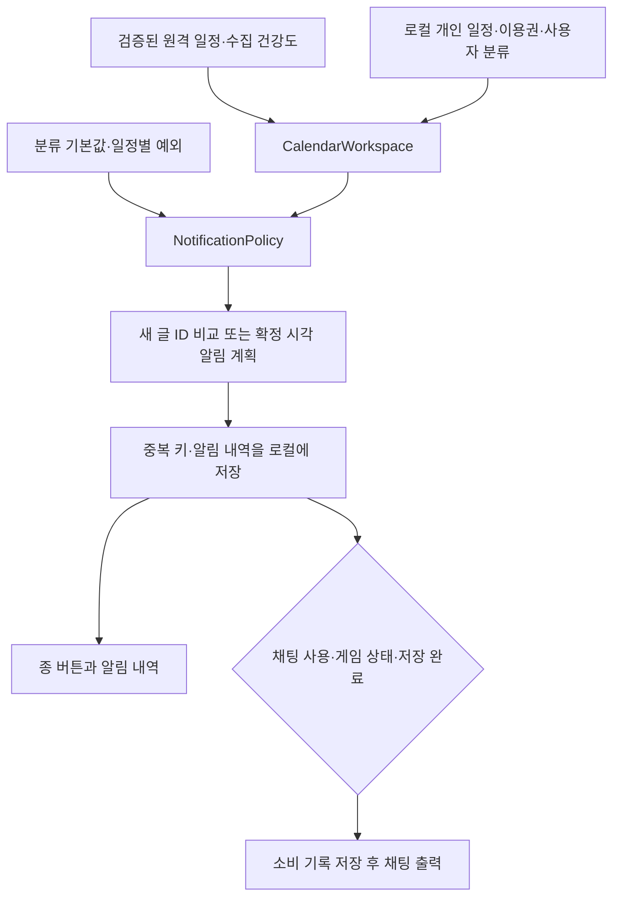

# 알림과 사용자 분류 · 0.3.2

2026-11-14. 공대 종류별 분류를 직접 만들고, 분류 기본 알림과 일정별 예외를 함께 사용하는 개발판이다. 요일별 시각을 지정한 유한 반복 일괄 등록을 지원한다. 무기한 자동 생성·공대원 명단·출석·공유는 포함하지 않는다.

## 사용 흐름

1. 설정 → **일정 색상 및 아이콘 → 분류 추가**에서 이름·아이콘·색상을 저장한다. 예: 절바하 공대, 영식 고정팟. 아이콘은 선택기 안에서도 실제 모양을 표시한다.
2. 개인 일정 추가/수정에서 분류를 선택한다. 날짜는 미니 달력으로 고르고 시간은 별도로 지정한다.
3. 상단 종 버튼 → **분류별 설정**에서 현재 시점과 켜짐 상태를 확인하고 바로 켜거나 끈다. **세부 설정**에서는 약속 시각·이용권 만료·이벤트 시작/참여 종료 등 대상에 맞는 시점을 정한다. 시점별로 최대 6개 알림을 설정할 수 있다. 정각·10분·30분·1시간·하루 전 버튼과 직접 분 입력을 제공한다.
4. 공개 일정 카드의 **알림 설정**, 직접 등록한 일정 카드의 **수정 → 알림**에서 `분류 기본값 따름 / 이 일정만 변경 / 이 일정 알림 끄기`를 선택한다. 묶음 카드에 여러 단계가 있으면 변경할 단계를 고른다.
5. 설정 아래 **개별 알림 설정 보기 (N건)**에는 예외만 모은다. 일정·분류 이름 검색과 12건씩 페이지 이동을 제공한다. **일정 찾아 알림 추가**에서는 전체 실행 일정을 검색한다.
6. 상단 종 버튼에서 미확인 수·알림 내역을 본다. 내역과 설정 목록은 메인 화면 안에 표시한다. 알림 세부 설정·일정 편집은 배경을 덮지 않는 독립 창이며 메인 화면을 닫아도 초안이 남는다. 읽음/모두 읽음·미확인만·읽은 내역 삭제를 제공한다. 일정 알림은 해당 날짜를 열고 새 공지·이벤트는 공식 링크를 연다. 대량 수신 묶음은 새소식으로 이동한다.

분류는 최대 64개이며 한 개인 일정에는 한 분류를 지정한다. 사용자 분류는 로컬 기기 전체에서 사용하고, 알림 기본값·일정별 예외는 현재 로컬 프로필에 속한다. 이름 변경은 고정 `user:` ID를 유지한다. 기본 ‘개인 일정’·‘공격대’도 일반 사용자 분류이며 삭제할 수 있다. ‘미분류’는 CategoryId가 빈 문자열인 분류 없음 상태이며 항상 등록·편집에서 선택할 수 있고 달력에 표시된다. 삭제 확인에서 다른 분류 또는 미분류를 목적지로 선택한다. 일정·메모·시각·개별 알림은 보존한다. 삭제한 분류의 기본 알림과 표시 필터만 제거한다. 사용자 분류 표시 여부는 미분류 표시 필터와 독립적이다. 이전 기본 개인 일정은 고정 user:default-personal 분류로 옮기고 스타일·분류 알림·표시 선택을 함께 보존한다. 기본 분류는 최초 한 번만 만들며 삭제 후 재실행해도 다시 추가하지 않는다.

## 기본값과 우선순위

| 항목 | 동작 |
| --- | --- |
| 알림 사용 | 새 설치 기본 꺼짐. 내역 기록의 전체 스위치 |
| 채팅으로도 알리기 | 기존 선택 유지, 새 설치 기본 꺼짐. 내역과 독립적인 출력 선택 |
| 새 공지·새 이벤트 | 기본 꺼짐. 켜면 검증된 원격 피드에서 처음 보는 ID를 감지 |
| 분류별 시간 알림 | 기본 꺼짐. 사용자가 켜야 적용 |
| 개인·사용자 분류 제안 시점 | 시작 1시간 전 |
| 이용권 제안 시점 | 만료 하루·1시간 전 |
| 기타 공개 분류 제안 시점 | 시작 1시간·마감 하루 전 |

우선순위는 **일정의 단계별 예외 → 이전 버전에서 직접 선택한 알림 → 분류 기본값 → 알림 없음**이다. ‘분류 기본값 따름’을 저장하면 해당 단계의 이전 개별 선택도 제거한다. 예외는 시작·마감 설정을 함께 교체하며, `끄기`는 해당 단계 전체 알림을 끈다. 표시 숨김과 알림 설정은 독립적이다.

날짜만 있거나 시각이 미발표·미확정이면 시간을 추측하지 않는다. 공개 일정 시간 알림은 출처가 최근 확인된 경우에만 보낸다. 전체 범위를 입증한 기존 건강도 검사를 통과하거나, 부분 수집에서는 해당 일정의 **모든 참조 근거가 같은 성공 수집에서 관찰된 항목**임을 확인한다. 근거 관찰 24시간, 수집 성공과 관찰 간격 5분, 피드 revision 일치, 영향을 주는 보류 변경 없음 조건을 검사한다. 이전 근거를 그대로 보존한 항목은 새 수집 성공 시각을 빌려 알리지 않는다. 개인 입력에는 공개 출처 검사가 필요 없다.

## 처리 구조

수집·게시·사용자 패칭 구조는 기존 [데이터 점검 보고](PIPELINE-AUDIT-2026-11-13.md)와 같다. 알림은 수집을 추가로 호출하지 않는다. 새 공지는 게시 순간의 실시간 푸시가 아니라 **수집·게시 후 사용자의 다음 정상 패칭에서 감지**한다. 첫 정상 원격 수신은 기준 ID만 저장하며 번들·예시·파일 가져오기는 이 기준을 만들지 않는다. 알림을 끈 동안 관찰한 ID도 기준에 포함하여 다시 켰을 때 몰아서 재전송하지 않는다. 같은 ID의 제목 수정은 새 글로 취급하지 않는다. 새 이벤트 감지는 공식 이벤트 수집 ID(`kr:event:`) 기준이다.

1초마다 게임 로그인 상태에서 로컬 계획을 검사한다. 시간 알림은 설정 시점부터 2분 이내의 지연만 허용한다. 게임을 꺼둔 사이 지난 알림을 시작 시 모두 재생하지 않는다. 전투·임무·PvP·로딩·영상 중에도 내역을 기록하지만 채팅은 기다린다. 대기 중 시각·설정이 바뀌면 출력 전에 재검사한다. 일정 경계가 15분 넘게 지났거나 새 글 수신 후 24시간이 지나면 늦은 채팅을 생략한다. 채팅을 끄면 이전 대기를 취소하며 나중에 켠다고 재생하지 않는다.

채팅은 최대 5건씩, 출력 간 최소 30초로 묶는다. 새 글이 종류별 5건을 초과하면 한 요약 내역으로 묶는다. 시간 알림은 1회 검사당 최대 20건씩 처리한다. 중복 키는 프로필·행사 ID·단계 ID·시작/마감·실제 경계 시각·선행 분을 길이 구분한 뒤 SHA-256으로 저장한다. 시각 변경은 새 경계로 취급한다. 알림 내역은 최근 200건, 영수증은 최대 4,096개/7일, 새 글 기준은 최대 5,000개를 보관한다. 이 한도를 넘는 극단적 장기·대량 이력의 영구 중복 제거를 보장하지 않는다.

채팅은 소비 기록을 먼저 저장한다. 저장 실패 중에는 출력하지 않는다. 기록 저장 직후 출력 전에 종료되면 해당 채팅은 누락될 수 있지만 알림 내역은 남는다. OS 푸시·소리·게임 종료 중 예약 실행은 제공하지 않는다.

## 저장 호환성과 검증

기존 JSON의 새 필드는 기본값으로 읽는다. 업그레이드 후 첫 저장 전에 유효한 이전 상태를 `state.pre-notifications-v1.json`으로 한 번 보존한다. 원본 형식으로 저장하고 이후 변경으로 덮어쓰지 않는다. 추가로0.3.2의 첫 유효 상태 저장 전에 원문 JSON 스냅샷 state.before-v032.json을 한 번 보존한다. 기존 스냅샷은 덮어쓰지 않는다. 사용자 분류·알림·내역은 공개 피드나 수집 서버로 전송하지 않는다.

Core 검사는 상속/예외/끄기/기존 선택, 여러 시점, 이동된 일정, 날짜만 입력, 새 글 기준/재수신/비활성, 대량 요약, 근거 신선도와 이전 JSON을 다룬다. Infrastructure 검사는 전투 대기·채팅 독립·저장 선행·실패 복구·재시작·시각 재검사·이전 형식 백업을 다룬다. Model은 실제 일정 투영·이름 변경·삭제 보존·표시 독립·내역 읽음을 검사한다. Native UI는 1/1.5/2배율에서 분류 생성·일정 지정·분류/개별 알림 저장을 실제 클릭하고 250개 일정의 검색 목록 페이지 처리를 확인한다.

실제 MainWindow의 DrawData를 차콜 일반 창과 미드나이트 작은 창에서 렌더링해 확인한다. 게임 GPU·게임 글꼴/DPI·실제 게임 채팅 전달은 별도 확인 대상이다. 자동 게임 재로드·수집기 원격 배포는 수행하지 않는다.

기존에 저장한 알림 선택을 임의로 초기화하지 않는다. 목록에서 껐다 켜도 지정 시점은 보존한다. 전체 스위치가 꺼져 있을 때 분류만 켜도 발송하지 않으며 화면에서 전체 꺼짐을 안내한다. 반복 등록/삭제 범위는 [별도 문서](WEEKLY-RAID-SCHEDULES.md)를 따른다.
