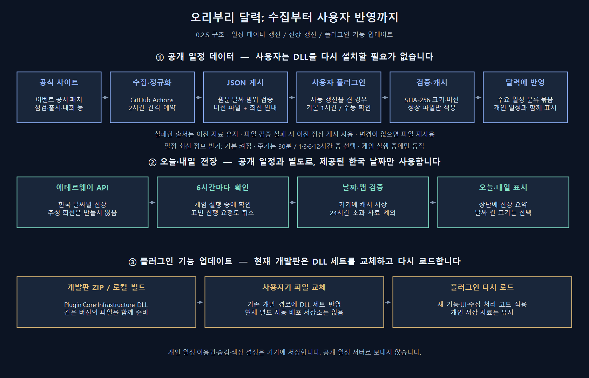

# 수집·게시·사용자 갱신 5회 점검

2026-11-13 · 수정본 0.2.3.0. 코드 검토 → 문제 재현 → 수정 → 회귀 검증을 5회 수행했다. 원격 운영 반영과 로컬 검증을 구분한다.

## 실제 운영에서 발견한 문제

[예약 수집 실행 43399545918](https://github.com/PlatyDuckbill/DuckbillCalendar/actions/runs/43399545918)은 작업 자체는 성공했지만, 운영 publication18의 `kr-notices`와 `kr-patch-catalog`는 실패 상태였다. 로컬에서도 같은 원문을 받아 `UnexpectedNoticeIndexShape`를 재현했다. 오늘 등록한 공지는 목록의 `time[datetime]`이 `17:00` 같은 시각만 담고 있었다. 기존 파서는 모든 행에 전체 날짜를 요구해서 공지 수집 전체를 중단했다.

수정 후 목록의 시각만 보존하고 공지 본문의 전체 KST 게시 시각과 대조한다. 실행 시각으로 날짜를 추측하지 않는다. 실제 재수집은 9개 출처 모두 오류 없이 99건을 얻었다. `partial`은 성공한 제한 범위를 뜻하며 사이트 전체 수집을 의미하지 않는다. 새 3건은 제재 현황·IDC 순단·크리스탈샵/가이드 점검 공지다. 새소식 자료이며 공지 게시일을 달력 일정으로 승격하지 않는다.

## 반복별 변경과 검증

| 회차 | 발견한 문제와 수정 | 확인한 결과 |
| --- | --- | --- |
| 1. 수집·병합 | 시각만 있는 당일 공지 허용 후 본문 날짜로 검증. 취소 ID가 병합 때 되살아나지 않게 처리. 해결된 조건 날짜의 근거 보존. 모든 출처가 불통인데 이전 자료를 새 성공으로 취급하던 경로 차단. 검토 대기를 해당 출처에만 연결 | 잘못된 시각/본문 불일치 거부, 전체 실패 시 진단만 보존하고 게시 feed 생성 금지. 실제 96→99건, 9개 출처 오류0 |
| 2. 게시·검증 계약 | 게시 도구·오프라인 검사·플러그인이 `Core.FeedPublication`의 같은 크기/SHA-256/스키마/지역/버전/예시 여부 검증 사용. 이전 게시 파일이 손상되면 새 게시 중단. 게시·health 기록의 잠금 통일. 백업 검증 전 활성 자료를 대입하던 복구 경로 수정 | 손상/중단/다른 버전/중복 작성/불변 파일 고아 사례 검사. 실제 원문99건→로컬 publication→실제 Workspace→달력 병합→재시작 통과 |
| 3. 전장 요청 수명 | 월 캐시 읽기·JSON 파싱·HTTP를 작업 스레드로 이동. 설정을 끄면 진행 요청 취소. 사용자 취소를 통신 실패로 계산하지 않음. Retry-After·압축 응답 거부·해제 시 자원 정리 보강 | 켜기/끄기/재시도, 429 대기, 오류 캐시 유지·24시간 만료 검사. 실제 HTTPS에서 오늘 워코 치테·내일 봉인된 바위섬 수신 |
| 4. 재시작·장기 캐시 | 실패 대기·서버 요청 제한·최근 요청 시각을 저장. health/재시도 저장과 별도로 이전 정상 payload 참조 보존. 오래된 SHA 이름 캐시만 정리. 전장 메모리는 제공 월 범위로 제한 | 8회 버전 갱신·반복 변경 없음 확인 뒤 최신 파일을 손상시켜도 이전 버전 복구/자동 수리. 정상 payload는 활성/이전/백업용 최대3개, 안정된 반복 확인 후2개. 진단 파일은 보존. 재시작으로 429 대기를 우회할 수 없음 |
| 5. 운영·아키텍처·최종 통합 | 공지와 패치 목록의 실패 범위 분리. 공유 모델/캐시 결과/화면 콜백 직렬화. 수집의 일부 실패를 Actions 경고·요약과 설정에 노출. 게시 전에 실제 소비자·재시작 검사를 자동화에 추가. 전체 검사에 독립 파이프라인 smoke 포함 | 공지 장애 중에도 패치 목록 처리, 3개 테마/3개 크기/3배율 회귀 검사. 최종 실수집99건·출처9개 오류0, 로컬 publication20을 실제 소비자가 적용하고 손상된 다음 파일은 거부 |

## 아키텍처 판단

`Core`는 날짜·분류·표시 투영과 검증 계약을 가진 순수 계층이다. 네트워크·파일·게임 API를 참조하지 않는다. `Infrastructure`는 제한된 HTTPS, 원자적 저장, 재시도·취소·복구를 담당한다. 수집기와 게시기는 게임 바깥의 별도 CLI다. `Plugin`은 화면·로컬 설정·게임 알림을 연결한다. 이 분리는 유지했으며 대규모 프레임워크를 추가하지 않았다.

검증 규칙의 중복과 백업 메타데이터 의존을 줄이고, 게임 프레임에서 전장 파일을 읽던 경로를 제거했다. Draw/Framework/명령/종료 콜백은 하나의 상태 잠금으로 직렬화한다. 이로써 동일한 콜백 스레드라고 가정하지 않는다. 네트워크나 파일 작업이 끝나기를 그 잠금 안에서 기다리지 않는다. 초기 플러그인 생성 시 로컬 설정/번들의 제한된 읽기는 남아 있다. [Dalamud Framework](https://dalamud.dev/api/Dalamud.Plugin.Services/Interfaces/IFramework/)와 [UiBuilder](https://github.com/goatcorp/Dalamud/blob/master/Dalamud/Interface/UiBuilder.cs)의 콜백 경계를 참고했다. 실제 게임 환경에서의 스레드/종료 재현을 대신하는 검사는 아니다.

개인 일정·이용권·숨김·색상은 공개 feed와 별도 파일에 저장한다. 공개 갱신이 이 설정을 교체하지 않는다. 원격 JSON은 실행 코드가 아니며, 서버에서 DLL을 받아 실행하는 기능도 없다.

## 사용자는 어떻게 갱신하는가

1. 일정: 현재0.2.5의 **일정 최신 정보 받기**는 새 설치에서 기본 켜짐이다(기존 끄기 선택은 유지). 플러그인이 실행 중이면 30분/1시간/3시간/6시간/12시간 중 선택한 간격으로 새 게시를 확인한다. 기본 간격은1시간이다. `지금 확인`도 사용할 수 있다. 시간은 마지막 확인/다음 확인과 원문 출처 확인을 구분한다.
2. 변경 없으면 ETag/캐시를 재사용한다. 새 버전이면 크기·SHA·스키마·지역·버전/예시 여부를 검사한 뒤 적용한다. 실패하면 기존 일정을 유지하며 재시도한다. 재시작 후에도 실패 대기와 서버 제한을 보존한다.
3. 전장: 별도 기본 켜짐 설정이다. 6시간마다 날짜별 API를 확인한다. 켜진 상태에서 오늘/내일 요약을 보여주며 날짜 칸 표시는 별도 선택이다. 24시간을 넘은 캐시는 사용하지 않는다.
4. 기능·UI·플러그인 코드: 현재 개발판에서는 같은 버전의 Plugin/Core/Infrastructure DLL과 메타데이터를 함께 준비하고 개발 플러그인을 다시 로드한다. 로컬 빌드는 `scripts/build.ps1`, 전달용 ZIP은 `scripts/prepare-dev.ps1`을 사용한다. 현재 저장소에 일반 사용자용 플러그인 자동 배포 저장소/Release workflow는 없다.

수집 예약은2시간 간격이고 클라이언트 확인은 별도 주기다. 원문 게시 직후 바로 보이는 실시간 시스템은 아니다. 원문 수집 대기+클라이언트 대기와 Actions/네트워크 지연이 합쳐진다. 게임 종료 중에는 요청·화면 알림이 실행되지 않는다.

## 검증과 산출물

- Core168 / Infrastructure172 / Model80 / native UI381 / 수집111 / CLI30 = **942개 검사**, 한국어 리소스222개. 별도로 게시→소비자→손상 유지→재시작의 통합 smoke와 실제 HTTPS 수신을 수행했다.
- 수집111개: 기본18, 자동 준비18, 공지23, 날짜 매핑18, 이벤트 페이지15, 전체 병합19.
- `scripts/check-pipeline.ps1`은 인터넷/게임 설정/원격 게시 없이 실제 게시 도구와 실제 Workspace를 연결한다. 일반 전체 검사에도 포함했다.
- 재현 자료: `.preview/pipeline-audit-6a19742d0e4f43288eeca3fc49d4468d/`. 최초 실패·수정 후·5차 최종 원문과 source 보고서를 보존했다.
- 검토용 자료: `artifacts/pipeline-audit-0.2.3/`의 99건 feed, source 결과, 로컬 current. **로컬 publication20은 운영 게시본이 아니다.**
- 그림 재생성: `./tools/render-pipeline-diagram.ps1`.

## 운영 적용과 남는 경계

이번 점검에서는 GitHub push, 운영 data branch 게시, Release 배포, 게임 자동 로드를 하지 않았다. 실제 원격 수신 재검사는 여전히 기존 publication18/96건을 받았다. 새 수집기·workflow는 소스 반영 후 운영 실행으로 확인해야 한다. 기존 번들96건을 로컬 미게시 revision으로 바꾸지도 않았다.

공식 사이트 구조가 다시 바뀌거나 검토한 날짜 문구가 달라지면 해당 출처를 실패/검토 대기로 남긴다. 자동으로 날짜를 추측하지 않는다. 수집 범위 제한과 이력 상한은 여전히 존재하며, GitHub의 불변 게시 이력에 대한 장기 보관 정책도 별도 운영 과제다. 게임 GPU/실제 글꼴·스레드/캐릭터 전환/실제 알림 전달과 수정 workflow의 실제 GitHub runner 실행은 로컬 통과 범위에 포함하지 않는다.
